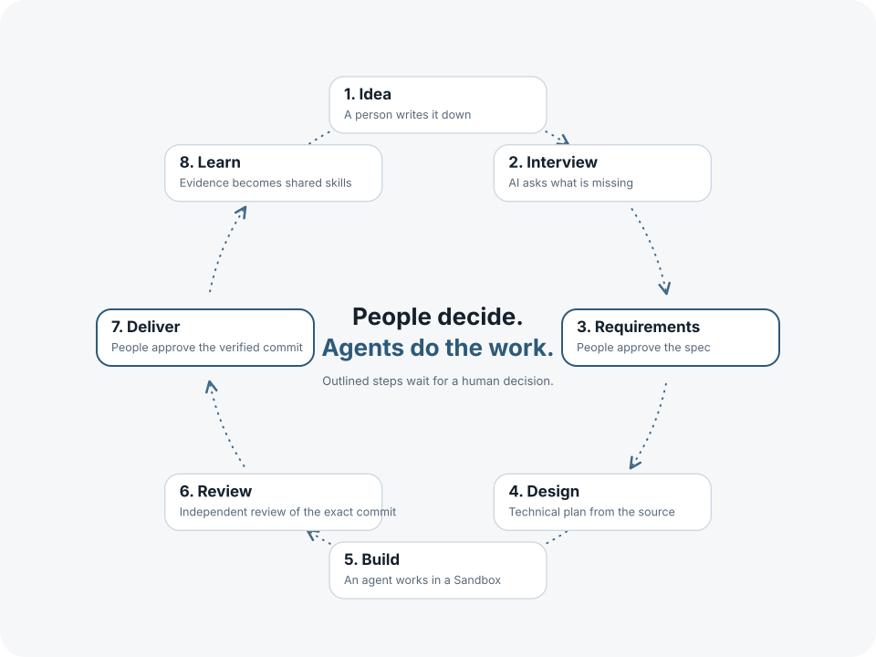
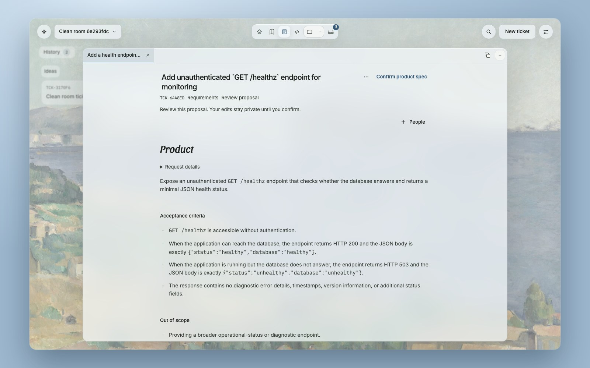
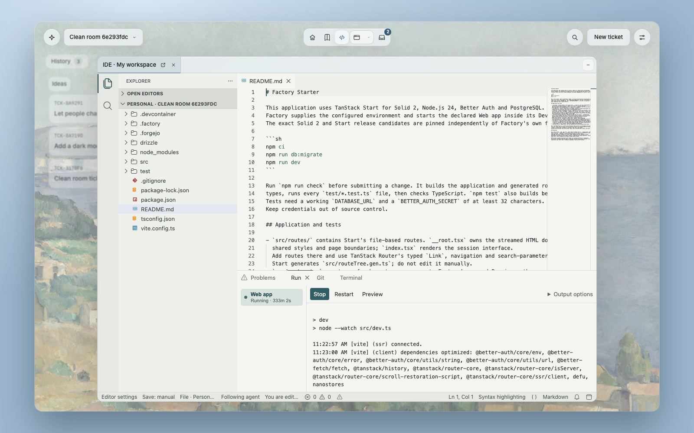
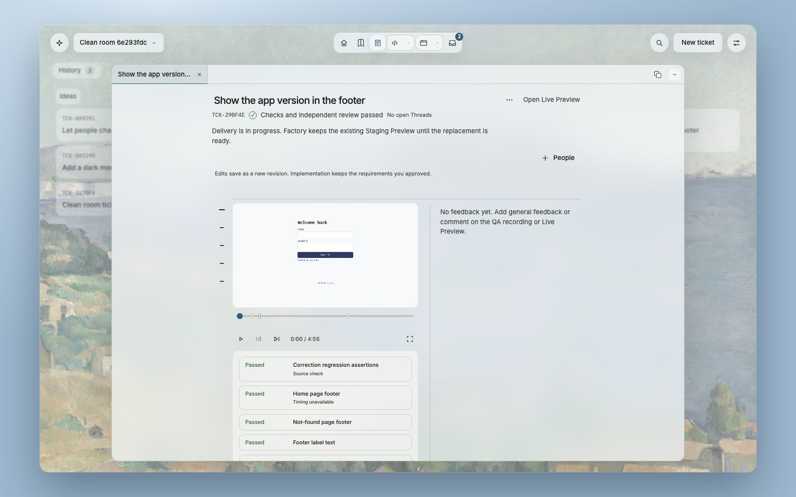
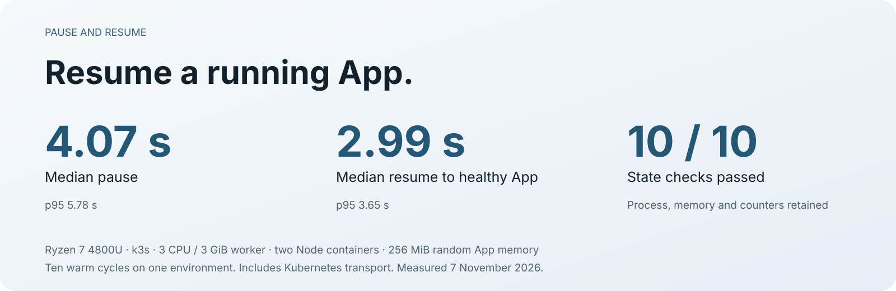

# Open Software Factory

Self-hosted software development with coding agents. Import your repository and Dev Container,
write requirements, and let an agent implement them. Tests and an independent review check the exact
commit before you approve delivery.

Runs on Kubernetes. Linux arm64 and amd64. Apache-2.0. No telemetry.

[Runtime direction](#runtime-direction) · [Install](#install) · [Develop](#developing)

## Runtime direction

Factory is moving to **Substrate as its sole execution runtime**, using the pinned official API
and gVisor profile with ROOTFS cold restart, private Docker and Dev Containers. Factory retains
product authority, approvals and execution intent; Substrate owns native lifecycle and snapshots.
See [the Substrate integration](deploy/substrate/README.md) for the implemented path and remaining gates.

The replacement is not yet a completed product cutover. The released chart still uses Factorybox;
native release publication, Staging and the complete approved Ticket journey remain unfinished.
Factorybox's historical warm-memory measurements below are not Substrate performance claims.

## The workflow

<picture>
  <source media="(prefers-color-scheme: dark)" srcset="assets/lifecycle-dark.svg">
  
</picture>

### Write requirements

Tickets hold the request, acceptance criteria and discussion. Write them yourself or ask the AI
Interview to read the repository and clarify missing decisions. Approve the product spec before
technical planning and implementation.



### Work with the agent

Each Sandbox has your Dev Container, a private Docker daemon and running services. Open the IDE
to inspect or edit the source. Open the Preview to use the App. The Substrate integration uses
cold restart rather than promising continuity of running processes.



### Review and deliver

Verification and independent review use the same commit. Review includes a recording of the App.
Your approval promotes the change to Staging. Production deployment remains your responsibility.



Project Wikis keep revisions and human edits. Roles separate product work, development and
administration. OpenBao encrypts secrets. Backups include Git, database, objects and secrets.
Learning proposals need approval before adoption.

## Use a local agent with Factory compute

Point a remote MCP client at `https://YOUR_FACTORY/api/mcp`. Sign in to Factory in your local
browser and approve that client. Factory uses user OAuth with PKCE. It does not import your local
browser sessions or model credentials. Your agent and browser stay local; shell commands and
interactive terminals run as the development user inside the selected Workspace's Dev Container.

Use `listProjects`, `listWorkspaces` and `openWorkspace` to select an existing Project or Workspace.
Personal development does not require a Ticket. `startWorkspace`, `pauseWorkspace` and
`stopWorkspace` control that Workspace's compute. Commands, terminals and container-file access
resume paused compute, but never silently restart explicitly stopped or failed compute. A laptop
disconnect does not cancel admitted remote commands. Use their returned IDs to observe outcomes.

For Ticket work, `listTicketWorkspaces` returns retained Changes and `openWorkspace` accepts their
`changeID`. `getWorkspaceEditing` reports the current editing phase. An explicit
`takeOverTicketEditing` uses Factory's existing handoff and its observed writer epoch before a
local agent can change a Ticket checkout. It does not start Coding or approve requirements.

File tools default to `location: "checkout"`, with paths relative to retained source. Those reads
do not wake compute. Select `location: "container"` for absolute paths inside the actual Dev
Container. `getContainerContext` reports its Workspace folder and effective user ID. Container
access requires development scope and collaboration permission. Keep the returned file version
when changing an existing file. Versions detect observed changes; they do not coordinate arbitrary
concurrent shell, formatter or Git writes, or save another editor's unsaved buffer.

For binary or larger files, `beginFileTransfer` binds an upload or download to one user, Workspace
and Runtime Attempt. Transfers support files up to 128 MiB and expire after 30 minutes. Use its
authenticated HTTP URL for raw chunks up to 256 KiB, or the MCP chunk tools for smaller chunks.
Send the MCP OAuth Bearer token in the `Authorization` header, never in the URL. An upload needs
its byte length and SHA-256, and `commitFileTransfer` publishes it only after verification.
Verify an assembled download against its reported SHA-256. `releaseFileTransfer` closes the
handle and removes only its own unpublished temporary file. File bytes do not enter product history.

Reuse request IDs only for the same deliberate operation. After a lost response, observe the
existing command or transfer rather than starting a replacement. Unknown outcomes are not success.
Command output and terminal scrollback are bounded and temporary. Save complete logs as files
deliberately if you need to retain them.

Personal Workspaces are private by default, including their development Previews. Their owner can
explicitly grant another current Project Developer observation or collaboration through
`shareWorkspace`. Participants use the same Dev Container, processes and Docker environment.
Removing access does not cancel already-started code or stop shared compute. Command cancellation
and Workspace Stop are separate actions. Project permissions remain the upper bound.

In the IDE, use **Share Workspace** to manage personal access or choose a shared Workspace. Shared
editing uses Yjs to merge document edits and show authenticated participants and cursors. Factory
retains the shared buffer without requiring the owner's browser to stay open. Save writes that
buffer to canonical source. If a shell, formatter or Git operation changes the saved file while
the shared buffer has unsaved edits, Factory keeps the buffer and reports a conflict. The editor's
conflict action compares both versions before you choose which to keep.

Local agents can use `readSharedDocument`, `editSharedDocument` and `saveSharedDocument` to work
with the same buffer. Reads are paged; edits require the exact observed revision. Agents appear
under their authenticated user and OAuth client, not as an anonymous editor.

For a Ticket Workspace in its human editing phase, **Enable shared editing** lets current Project
Developers collaborate. **Submit saved checkout** captures the saved shared source for normal
exact-commit Verification and independent review. Unsaved shared buffers must be saved or resolved
first. Submission is not requirements approval, a passing review, or Delivery approval.

For OpenCode V2, add the remote server with `opencode mcp add factory --url https://YOUR_FACTORY/api/mcp`,
then use `/mcps` to sign in. Other MCP clients use the same URL and OAuth flow. No Factory-specific
agent plugin is required.

## Released Factorybox measurements



Ten warm cycles on one Ryzen 7 4800U node with k3s, a 3-CPU / 3-GiB worker, two Node containers
and 256 MiB of random App memory. Times include Kubernetes transport. All ten restores preserved
the process, memory and counters. These are warm restore times, not cold starts or Substrate results.
[Samples](assets/story/lifecycle.json) · [Measurement command](scripts/runtime/README.md).

## Isolation

The released [Factorybox](https://github.com/maxcodefaster/factorybox) runtime runs user-namespaced
system containers with Sysbox and checkpoints their RAM and filesystem with CRIU. Its outer worker
is privileged and shares the node kernel. Use separate installations and nodes for mutually
untrusted tenants. The [chart guide](deploy/helm/factory/README.md) covers node, storage and network
requirements; the [Substrate profile](deploy/substrate/README.md) documents the replacement's boundary.

## Install

```sh
helm install factory oci://ghcr.io/maxcodefaster/charts/factory --version 0.1.0-beta.1 \
  --namespace factory --create-namespace --values private-values.yaml \
  --wait=legacy --timeout 20m
```

Set the node, public addresses and Ingress in `private-values.yaml`. The chart supplies the services
and credentials and pins signed images. On amd64, also pass the released
[worker values](https://github.com/maxcodefaster/open-software-factory/releases/download/v0.1.0-beta.1/factory-amd64-0.1.0-beta.1.yaml).
[Installation, backups and recovery](deploy/helm/factory/README.md).

## Developing

On macOS with OrbStack and [mise](https://mise.jdx.dev):

```sh
mise install
mise exec -- bun install --frozen-lockfile
mise exec -- bun run factory:up
```

Open http://127.0.0.1:3000. The launcher prints the generated administrator-password file.
Configure model connections in Settings. Calls send context to the model provider you select.

`bun run check` checks source and the Connector. `bun run check:integration` adds database and
controller tests. `bun run test:browser` runs UI journeys. `bun run beta:gate` writes a release
receipt. Native runtime and clean-install commands are in [scripts/runtime](scripts/runtime/README.md)
and the [chart guide](deploy/helm/factory/README.md). GitHub checks run only for releases or by request.

Built with Solid 2, TanStack Start, Bun, PostgreSQL, Zero, Mastra, OpenCode and Forgejo.
[AGENTS.md](AGENTS.md) holds contributor rules. Report bugs in GitHub Issues and vulnerabilities
through [SECURITY.md](SECURITY.md). [Apache-2.0](LICENSE); bundled assets keep their own notices.
