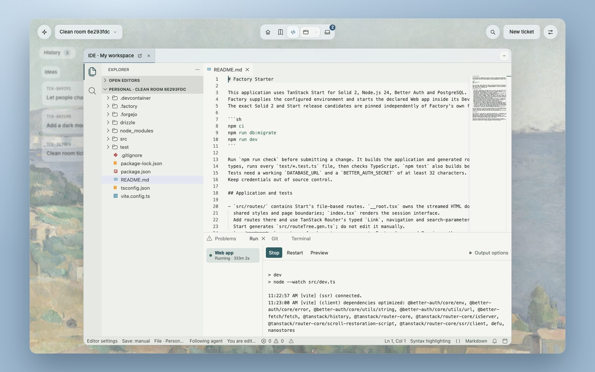

# Open Software Factory

Self-hosted software development with coding agents. Import your repository and Dev Container,
write requirements, and let an agent implement them. Tests and an independent review check the exact
commit before you approve delivery.

Runs on Kubernetes with Linux arm64 and amd64 artifacts. The Substrate profile pins both worker
architectures; [qualification scope](deploy/substrate/README.md#qualification-scope) distinguishes
the live ARM product path from component and packaging checks. Apache-2.0. No telemetry.

[Runtime direction](#runtime-direction) · [Install](#install) · [Develop](#developing)

## Runtime direction

Factory uses **Substrate as its sole execution runtime**, using the pinned official API
and gVisor profile with ROOTFS cold restart, private Docker and Dev Containers. Factory retains
product authority, approvals and execution intent; Substrate owns native lifecycle and snapshots.
See [the Substrate integration](deploy/substrate/README.md) for the supported contract and qualification limits.

Factorybox execution, the execution reserve and worker recovery have been removed. This is a
Greenfield installation, with no old-runtime compatibility or data-transfer path. The chart requires
installation-wide native configuration, and the distribution build packages a separate
multi-architecture Actor image. Workspace compute, prebuilds, Verification, Staging, promotion and
publication use the official runtime through Factory's adapters.

## The workflow

<picture>
  <source media="(prefers-color-scheme: dark)" srcset="assets/lifecycle-dark.svg">
  
</picture>

### Write requirements

Tickets hold the request, acceptance criteria and discussion. Write them yourself or ask the AI
Interview to read the repository and clarify missing decisions. Approve the product spec before
technical planning and implementation.


### Work with the agent

Each Sandbox has your Dev Container, a private Docker daemon and running services. Open the IDE
to inspect or edit the source. Open the Preview to use the App. The Substrate integration uses
cold restart rather than promising continuity of running processes.



### Review and deliver

Verification and independent review use the same commit. Review includes a recording of the App.
Recordings shorten runs of identical captured frames, not the QA itself. Their playback time is
not a performance measurement.
Your approval promotes the change to Staging. Production deployment remains your responsibility.


Project Wikis keep revisions and human edits. Roles separate product work, development and
administration. OpenBao encrypts secrets. Backups include Git, database, objects and secrets.
Learning reviews completed work and compact native tool evidence, including repeated discovery.
Its proposals need approval before adoption; repeated calls alone do not prove wasted work.
Personal Skills stay private in personal Project conversations. Exact Skill versions admitted to
shared Ticket work are inspectable by that Project's members; this does not share the private library.
Skills use one per-library choice model for settings, configuration checks and admission.
System and Project managers can require exact versions; lower scopes cannot override those choices.
Changing publication or defaults does not rewrite guidance already admitted to a turn.

## Use a local agent with Factory compute

Point a remote MCP client at `https://YOUR_FACTORY/api/mcp`. Sign in to Factory in your local
browser and approve that client. Factory uses user OAuth with PKCE. It does not import your local
browser sessions or model credentials. Your agent and browser stay local; shell commands and
interactive terminals run as the development user inside the selected Workspace's Dev Container.

Use `listProjects`, `listWorkspaces` and `openWorkspace` to select an existing Project or Workspace.
Personal development does not require a Ticket. `startWorkspace`, `pauseWorkspace` and
`stopWorkspace` control that Workspace's compute. For a fresh Project with no Workspace row, call
`startWorkspace` with `projectID` and a new `requestID` to explicitly initialize and start your personal
Workspace. Start accepts exactly one of `projectID` or `workspaceID`; Pause and Stop require
`workspaceID` and `requestID`. List and Open never perform this first Start.
Commands, terminals and container-file access resume paused compute, but never silently restart
explicitly stopped or failed compute. A laptop disconnect does not cancel admitted remote commands.
Use their returned IDs to observe outcomes.

For Ticket work, `listTicketWorkspaces` returns retained Changes and `openWorkspace` accepts their
`changeID`. `getWorkspaceEditing` reports the current editing phase. An explicit
`takeOverTicketEditing` uses Factory's existing handoff and its observed writer epoch before a
local agent can change a Ticket checkout. It does not start Coding or approve requirements.

File tools default to `location: "checkout"`, with paths relative to retained source. Those reads
do not wake compute. Select `location: "container"` for absolute paths inside the actual Dev
Container. `getContainerContext` reports its Workspace folder and effective user ID. Container
access requires development scope and collaboration permission. Keep the returned file version
when changing an existing file. Versions detect observed changes; they do not coordinate arbitrary
concurrent shell, formatter or Git writes, or save another editor's unsaved buffer.

In the IDE, **Retry file access** rechecks the same retained Source owner. It does not stop or
replace Source, start compute or reload the editor's unsaved buffer. Workspace Stop controls
compute separately and retains independent Source before deleting its original Actor.

For binary or larger files, `beginFileTransfer` binds an upload or download to one user, Workspace
and Runtime Attempt. Transfers support files up to 128 MiB and expire after 30 minutes. Use its
authenticated HTTP URL for raw chunks up to 256 KiB, or the MCP chunk tools for smaller chunks.
Send the MCP OAuth Bearer token in the `Authorization` header, never in the URL. An upload needs
its byte length and SHA-256, and `commitFileTransfer` publishes it only after verification.
Verify an assembled download against its reported SHA-256. `releaseFileTransfer` closes the
handle and removes only its own unpublished temporary file. File bytes do not enter product history.

Reuse request IDs only for the same deliberate operation. After a lost response, observe the
existing command or transfer rather than starting a replacement. Unknown outcomes are not success.
Command output and terminal scrollback are bounded and temporary. Save complete logs as files
deliberately if you need to retain them.

Personal Workspaces are private by default, including their development Previews. Their owner can
explicitly grant another current Project Developer observation or collaboration through
`shareWorkspace`. Participants use the same Dev Container, processes and Docker environment.
Removing access does not cancel already-started code or stop shared compute. Command cancellation
and Workspace Stop are separate actions. Project permissions remain the upper bound.

In the IDE, use **Share Workspace** to manage personal access or choose a shared Workspace. Shared
editing uses Yjs to merge document edits and show authenticated participants and cursors. Factory
retains the shared buffer without requiring the owner's browser to stay open. Save writes that
buffer to canonical source. If a shell, formatter or Git operation changes the saved file while
the shared buffer has unsaved edits, Factory keeps the buffer and reports a conflict. The editor's
conflict action compares both versions before you choose which to keep.

Local agents can use `readSharedDocument`, `editSharedDocument` and `saveSharedDocument` to work
with the same buffer. Reads are paged; edits require the exact observed revision. Agents appear
under their authenticated user and OAuth client, not as an anonymous editor.

For a Ticket Workspace in its human editing phase, **Enable shared editing** lets current Project
Developers collaborate. **Submit saved checkout** captures the saved shared source for normal
exact-commit Verification and independent review. Unsaved shared buffers must be saved or resolved
first. Submission is not requirements approval, a passing review, or Delivery approval.

For OpenCode V2, add the remote server with `opencode mcp add factory --url https://YOUR_FACTORY/api/mcp`,
then use `/mcps` to sign in. Other MCP clients use the same URL and OAuth flow. No Factory-specific
agent plugin is required.

## Isolation

The pinned Substrate profile uses gVisor, an Actor-private Docker daemon and restricted TLS egress.
ROOTFS snapshots restart processes and connections; Factory does not promise memory continuity.
Actor-level resource limits are the enforcement boundary, not per-inner-container cgroups.
The [Substrate profile](deploy/substrate/README.md) records trust, networking and qualification
limits. The [chart guide](deploy/helm/factory/README.md) covers installation requirements.

Runtime inventory shows saved Factory state, not current Actor health. Reading that list does
not contact Substrate. Explicit runtime observation and lifecycle commands retain their native
owner and live-state checks.

## Install

```sh
mise exec -- kubectl create namespace factory
mise exec -- kubectl label namespace factory ate.dev/api-access=true
mise exec -- helm install factory ./deploy/helm/factory \
  --namespace factory --create-namespace --values private-values.yaml \
  --wait=legacy --timeout 20m
```

Supply the exact application image, public TLS origins, installation-wide Substrate configuration
and separately rotated native provisioner credential in `private-values.yaml`. Install and qualify
the pinned official runtime on workers matching the selected Linux arm64 or amd64 identity first. The chart supplies the Factory data
services and credentials. Use the exact images qualified for the selected architecture; a source-chart
qualification is not publication of a new Factory release.
With Ingress enabled, the chart creates its own CA and renews its HTTPS certificates automatically.
The default issuer needs no manually generated certificate, private key or CA file.
It distributes public trust to native workloads without mkcert, OrbStack or a public DNS service.
Clients still need to trust that CA, and the installation needs reachable DNS and an Ingress controller.
An existing enterprise TLS Secret can replace the built-in issuer.
The Namespace label admits trusted Factory clients through Substrate's API NetworkPolicy;
it does not grant native authority. Keep execution and editor namespaces unlabelled.
[Installation, backups and recovery](deploy/helm/factory/README.md).

## Developing

On macOS with OrbStack and [mise](https://mise.jdx.dev):

```sh
mise install
mise exec -- bun install --frozen-lockfile
# Supply native configuration, reachable TLS origins and a released browser-tools image:
# FACTORY_SUBSTRATE_WORKSPACES_CONFIGURATION, FACTORY_FORGEJO_PUBLIC_URL, FACTORY_BROWSER_TOOLS_IMAGE
mise exec -- bun run factory:up
```

Open http://127.0.0.1:3000. The launcher prints the generated administrator-password file.
Configure model connections in Settings. Calls send context to the model provider you select.

Source-launcher test lanes using `factory-mutation/runtime-fixture` need explicit preparation
after their owned disposable installation starts. Ordinary `factory:up` does not seed or repair it:

```sh
mise exec -- bun scripts/factory/index.ts prepare-fixture --disposable YOUR_PROOF --confirm YOUR_PROOF
```

Preparation never removes branch protection. Do not rerun preparation over retained release work.

The complete `runtime-artifacts.json` contains four roles: `runtime-host`, `browser-tools`,
`developer-ide` and `substrate-runtime`. Native `workloadImage` must match that Actor artifact exactly.
Source-development publication consumes the supplied native Actor and browser images. It builds
the host tools and IDE images separately. The Factory and Actor images embed the native Source
service; there is no separate Source image. Publication does not substitute arm64 host binaries or
the local port-5000 registry for native browser and Starter dependencies.

Factory and the Starter use Solid 2 with TanStack Start RC11 and the fixed upstream
`start-server-core` 1.169.45. A metadata-only package repair exposes the existing native
request-scope module omitted from that release's exports. Installation applies it automatically;
no upstream implementation is copied or changed. The old security backport is removed.
The Starter bundles TanStack before Nitro packages the production server.
IDE diagnostics use project language tools, not a browser-only TypeScript compiler.
TypeScript 6 remains required by compiler API-based test tooling and the packaged language server;
TypeScript 7's CLI does not provide those JavaScript compiler or `tsserver` APIs.
Runtime and data-service upgrades need their native and backup checks, not only a newer lockfile.

Database tables, enums, defaults, keys, indexes and checks live in the feature-grouped Drizzle
models under `packages/db/src/schema/`. `bun run db:generate` composes them with owned native
PostgreSQL routines and triggers under `packages/db/native/` into the single sealed Greenfield
baseline. `bun run db:check` detects source drift. Operators install that checked-in baseline;
they do not run a generator or adopt a historical database.

Schema-backed Drizzle queries cover Project setup, Models, Ticket authoring, Coding admission,
Delivery, Source and IDE access, Workspace sharing/commands/files, Monitoring, Knowledge, Learning,
Releases and attachment/media storage. `drizzleTransaction` binds queries to the existing
Postgres.js transaction, including nested savepoints, or an explicitly reserved connection.
It does not open a second connection. Remaining direct queries own native locks,
compound authority predicates, aggregates, search and native PostgreSQL expressions. Zero reuses its
database provider per connection pool, not a user's authorization context.
Its eight planning tables are generated from an explicit Drizzle column allowlist with
`bun run zero:generate`; `bun run zero:check` rejects drift. Authorization joins remain explicit.
The generator is development-only, and the browser imports only its checked-in output.
Project registration and repository setup share `projects/creation.ts`. It selects the shared
background under a transaction lock; PostgreSQL no longer owns that product selection policy.
Runtime Attempts and Workspaces have no runtime-selector flag. Every Attempt requires its
persisted matching native binding, including at the deferred transaction boundary.

Mastra owns Planning orchestration. Explicit provider SDKs remain behind the model adapter because
Mastra's compatible endpoint route does not preserve every native provider's protocol and reasoning
semantics. Build probes use OpenCode's native Promise API; Factory no longer imports Effect directly.
Effect remains an upstream OpenCode requirement. Tiptap packages upgrade together; qualified Marked
and Highlight.js overrides keep the reader and editor on one implementation of each parser.

`factory:reset` is restricted to an explicitly named disposable installation and matching
confirmation. It refuses active runtime work or unconfirmed Coding Stop. Before removing its
Compose data volumes, it checks that every recorded native scope, Developer IDE Namespace and
additional native WorkerPool is absent. Unconfirmed creates refuse reset even when a read finds
no resource. This includes incomplete provisioning intents. It does
not delete Substrate resources for you or reset the developer installation.

`bun run check` checks source and the Connector. `bun run check:integration` adds database and
controller tests. `bun run test:browser` runs UI journeys. `bun run beta:gate` writes an exact-commit
source/controller/UI receipt, including Connector and Substrate bridge checks. It is not native
product acceptance. Native runtime and clean-install commands are in [scripts/runtime](scripts/runtime/README.md)
and the [chart guide](deploy/helm/factory/README.md). GitHub checks run only for releases or by request.

For an affected controller check, select its exact path. Database-only checks skip the application
build; compiled endpoint checks retain it:

```sh
mise exec -- bun run test:controllers test/integration/inbox.test.ts
```

Built with Solid 2, TanStack Start, Bun, PostgreSQL, Zero, Mastra, OpenCode and Forgejo.
[AGENTS.md](AGENTS.md) holds contributor rules. Report bugs in GitHub Issues and vulnerabilities
through [SECURITY.md](SECURITY.md). [Apache-2.0](LICENSE); bundled assets keep their own notices.
