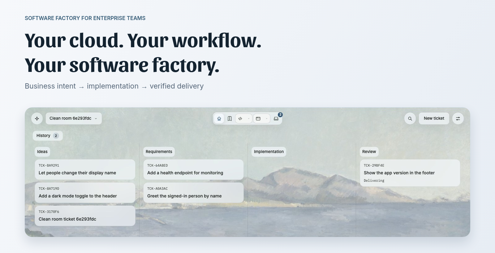
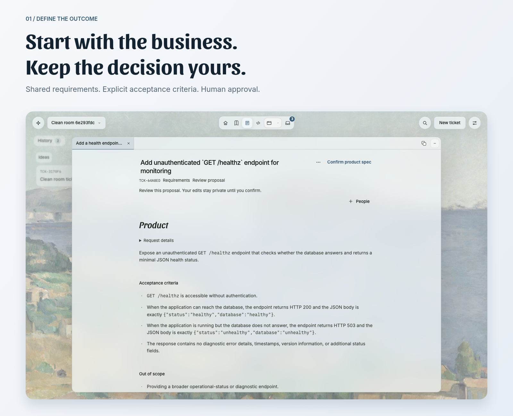
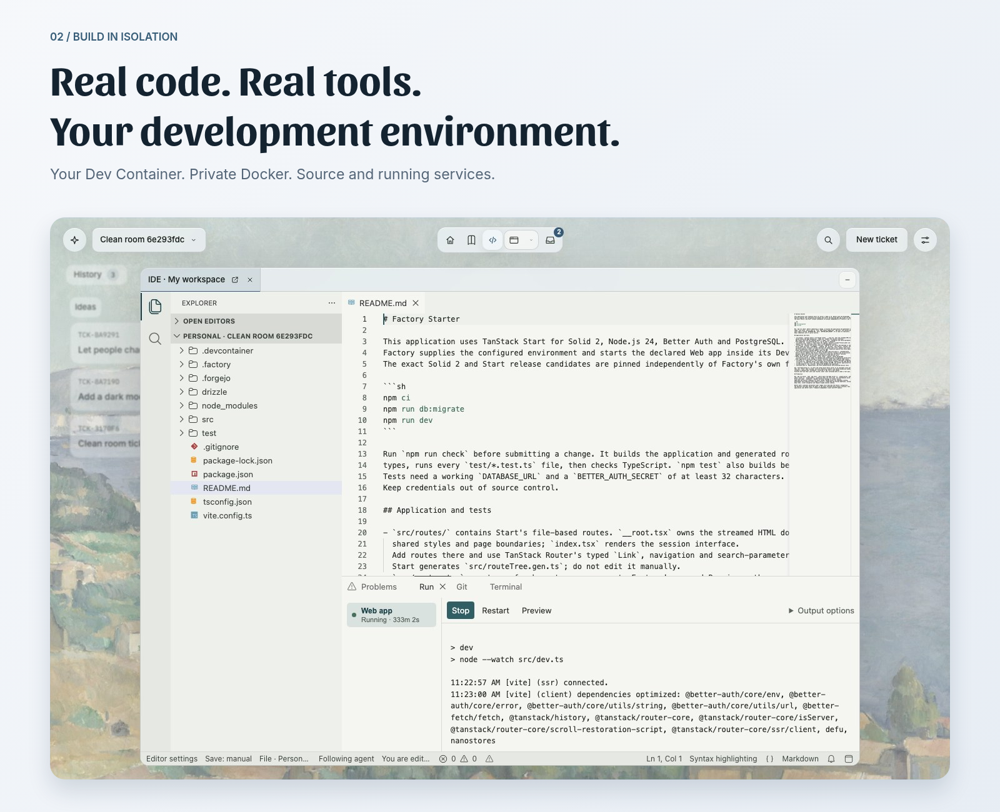
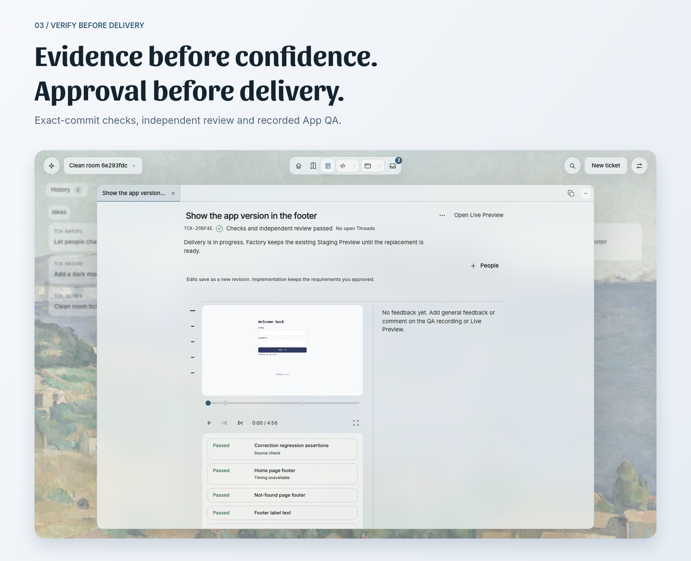

<div align="center">



# Open Software Factory

**Your cloud. Your workflow. Your software factory.**

A self-hosted software factory for enterprise teams. Turn business intent into verified software:
business teams, developers and coding agents in one delivery workflow, on Kubernetes you control.

[](LICENSE)
[](https://github.com/maxcodefaster/open-software-factory/releases)
[](#where-it-runs)
[](SECURITY.md)

[Why](#why-factory) · [The cycle](#the-cycle) · [Features](#features) · [Performance](#performance-with-context) · [Factory Box](#factory-box) · [Where it runs](#where-it-runs) · [Install](#install) · [Develop](#developing)

</div>

---

## Why Factory

Your team already has a product, a repository and a way to decide what changes. Factory connects
those decisions to agent execution: business teams define the outcome, developers work with real
source and tools, and people approve the verified commit before delivery.

Bring your existing Git history and Dev Container, rather than rewriting your application for an
agent platform. Project requirements, environment settings, model choices and approved instructions
make the workflow fit the work. An AI Interview is optional; writing requirements needs no model.

- **Fits your workflow.** From a business request to testable requirements, implementation,
  independent review and a deliberate delivery decision. The source, approvals and history stay connected.
- **Runs real projects.** Agents use your project's Dev Container, private Docker daemon and running
  services. People can open the IDE and Preview, inspect the work or continue it themselves.
- **Keeps you in control.** Task-scoped execution, scoped secrets, checks on the exact commit and
  recorded human approval. Idle development Sandboxes pause with their memory; progress is retained,
  not rebuilt from scratch on every visit.

Factory is open source, self-hosted and sends no telemetry. Git is held in your Forgejo, secrets in
your OpenBao, and you choose the model connections. Model calls send their authorized context to
the provider you select. Self-hosting is not a claim that inference stays on your node.

## The cycle

<picture>
  <source media="(prefers-color-scheme: dark)" srcset="assets/lifecycle-dark.svg">
  
</picture>

## Features

### Business intent. One shared delivery workflow.



Tickets move from Ideas through Requirements and Implementation to Review. Every Project has its own
board, History and Trash. Share a Ticket with the people who define the outcome and the people who
build it. Write requirements directly, with a summary and independently testable acceptance criteria.

Ask AI to clarify when you want an Interview: it reads the repository first and asks what the source
cannot settle. A technical design can follow from the real code. Reading and saving do not start
inference. Implement approves the exact saved requirements and commissions Coding.

### Real code. Real tools. Isolated execution.



Implementation runs in a Sandbox with your Project's Dev Container. Keep your package manager,
build commands, databases and service stack. Open the IDE while an agent works and follow its edits;
open the Preview to see the running App, not a description of it. The editor is an independent service,
so source access does not require keeping execution compute awake.

### A verified change. A deliberate decision.



Verification runs on the exact commit. An independent reviewer reads that same commit and records a
QA session of the running App. Factory retains the checks, review and decision that authorized the
change. Delivery promotes the approved change to the project's Staging Preview; operating a production
application is a separate deployment responsibility.

### Knowledge, access and continuity

- **Knowledge that follows the source.** Generate Wiki guides with a configured model. Pages keep
  revisions and human edits. Repeated corrections can become proposed instructions; people decide
  what is adopted.
- **Roles and scoped secrets.** Separate product work, development and administration. Environment
  values are scoped, encrypted in OpenBao and hidden in the interface.
- **Backups and recovery.** Back up database, Git, objects and secrets together. Restore rehearsals
  check recovery rather than assuming a successful backup is enough.
- **Pause compute, not progress.** Idle development Sandboxes release their anonymous RAM and resume
  the same processes. Retained snapshots and disk still occupy storage, and Staging stays running
  for reviewers. Pausing a Sandbox does not automatically stop or reduce the bill for a cloud node.

The illustrations above frame the repository's existing public demo screenshots. They are not new
live recordings, and the same images remain available in [assets/screens](assets/screens).

## Performance with context


Two running Node containers, a persistent volume and 256 MiB of random application memory. Across
ten warm restores, the process ID, memory hash, request counter and container identities survived.
The Sandbox's anonymous RAM dropped to zero after every pause.

| Operation | Median | p95 |
| --- | ---: | ---: |
| Pause until capture is confirmed | 4.07 s | 5.78 s |
| Resume until the App answers its state probe | 2.99 s | 3.65 s |

Measured on 7 November 2026, on a Ryzen 7 4800U Linux node with k3s, a 3-CPU / 3-GiB worker limit
and ten cycles on one warm environment. Times include Kubernetes transport. These are lifecycle
measurements, not cold-start times or a provider speed ranking.
[Samples and hardware](assets/story/lifecycle.json) · [Reproduce the measurement](scripts/runtime/README.md).

For provider pricing and workload comparisons, see [Battleships](https://battleships.dev/).

## Factory Box

Every Sandbox runs in **Factory Box**, a separate runtime that Factory uses as its execution layer
([maxcodefaster/factorybox](https://github.com/maxcodefaster/factorybox)). It runs each Sandbox as a
Linux system container on [Sysbox](https://github.com/nestybox/sysbox), so the Sandbox can run its own
Docker daemon without a privileged container. It uses [CRIU](https://criu.org) to checkpoint a running
Sandbox, RAM included, and restore it later.

The philosophy is practical. A microVM supplies a separate guest kernel but needs hardware
virtualization, which is not available on every managed node type. Factory Box instead uses Linux
system containers: a full development environment with private Docker, without KVM or a special
kernel build. That is a different trust boundary, not a claim of VM-equivalent security.

| | Plain container | gVisor | MicroVM (Firecracker, Kata) | **Factory Box** |
| --- | --- | --- | --- | --- |
| Kernel | Shared with the node | Userspace kernel | Own guest kernel | Shared with the node |
| Docker daemon inside | Requires suitable privileges or a rootless setup | Depends on runtime support | Yes, with suitable guest privileges | Yes, private per Sandbox |
| Pause with memory | Requires checkpoint tooling | Checkpoint support | Snapshot support depends on runtime | Yes, in seconds |
| Needs hardware virtualization | No | No | Yes | No |
| Node requirement | Container runtime | Configured sandbox runtime | Hardware virtualization and runtime | Admitted Linux capabilities and privileged worker Pod |
| Trust boundary | Shared host kernel | Userspace kernel intercepts system calls | Separate guest kernel | User-namespaced system containers; shared host kernel |

The outer worker is privileged and shares the node kernel; its project
containers do not receive the node Docker socket or Kubernetes ServiceAccount. User namespaces and
scoped capabilities are not an independent guest kernel. Keep each worker in one trust domain and
give mutually untrusted tenants their own installations and nodes. The capability check admits
compatible nodes. Keep node kernels patched and isolate worker network access as described in the chart README.

## Where it runs

Factory is deployed through one Helm chart, with no cloud-specific resources or custom operator.
Choose Kubernetes infrastructure, storage, DNS and model connections you control. Laptop clusters,
on-premises servers and managed clusters use the same deployment contract.

The worker needs an admitted Linux node and permission for a privileged worker Pod. It checks kernel
capabilities before admitting a Sandbox. The current control plane is a single-instance deployment;
adding nodes alone does not provide high availability or automatic execution scale-out. Read the
[chart README](deploy/helm/factory/README.md) for its precise storage and trust requirements.

Factory and its runtime images are published for Linux arm64 and amd64. Workers are pinned separately
for each architecture because their executable hashes differ.

## Install

```sh
helm install factory oci://ghcr.io/maxcodefaster/charts/factory --version 0.1.0-beta.1 \
  --namespace factory --create-namespace --values private-values.yaml \
  --wait=legacy --timeout 20m
```

`private-values.yaml` names your node and your public addresses. The chart pins the released Factory
image and the signed worker, and generates every credential. The
[chart README](deploy/helm/factory/README.md) covers prerequisites, storage, backups, node hardening,
managed clusters and recovery. On an amd64 node, also pass the released
[amd64 worker values](https://github.com/maxcodefaster/open-software-factory/releases/download/v0.1.0-beta.1/factory-amd64-0.1.0-beta.1.yaml).
From v0.1.0 on, chart upgrades are tested with retained data.

## Developing

Source development needs macOS with OrbStack (Linux Docker daemon, Kubernetes context `orbstack`)
and [mise](https://mise.jdx.dev).

```sh
mise install
mise exec -- bun install --frozen-lockfile
mise exec -- bun run factory:up
```

Open [http://127.0.0.1:3000](http://127.0.0.1:3000). The launcher generates the administrator password
for `admin@factory.local`, writes it to `.factory/` and prints the path. Provider connections are
configured in Settings, and [.env.example](.env.example) lists optional bootstrap values.

| Command | Purpose |
| --- | --- |
| `bun run check` | Docs, format, lint, types, unit tests and Connector checks |
| `bun run check:integration` | Adds PostgreSQL invariants and the owned controller lane |
| `bun run test:browser` | UI journeys against an owned Factory |
| `bun run test:native` | Real OpenCode, source, Forgejo and OpenBao adapters |
| `bun run runtime:conformance` | Factory Box, Kubernetes, Dev Containers and Connector together |
| `bun run beta:gate` | Every lane plus secret and forbidden-term scans, with a receipt for the exact commit |
| `bun run release:clean-room` | Install a chart on a fresh Namespace, prove it works, remove it |
| `bun run release:upgrade-test` | Upgrade a previous build on a fresh Namespace and prove no data is lost |
| `bun run release:soak` | Long run with Preview, pause, resume, Wiki and backup cycles |

GitHub runs the checks only for release tags and by hand. [AGENTS.md](AGENTS.md) holds the rules for
coding agents in this repository.

```text
apps/factory/               Web interface, HTTP server and Factory controllers
packages/                   Domain rules and concrete integration adapters
services/runtime-connector/ Go connector inside the approved runtime
deploy/                     Helm chart, upstream compositions and runtime images
scripts/                    Local operation, integration, release and runtime tools
templates/starter-app/      Maintained application scaffold for new Projects
test/                       Browser, integration and live proofs with owned fixtures
```

## Built on

TanStack Start with Solid 2, Bun and PostgreSQL. Zero syncs the interface. Mastra runs research and
interviews. OpenCode implements approved Changes. Forgejo owns Git and Verification. Sysbox and CRIU run
the Sandboxes inside Factory Box. OpenBao holds the secrets.

## Contributing and security

Report bugs as GitHub issues. Report vulnerabilities as described in [SECURITY.md](SECURITY.md).
Factory is licensed under [Apache-2.0](LICENSE). Bundled third-party assets keep their own notices.
