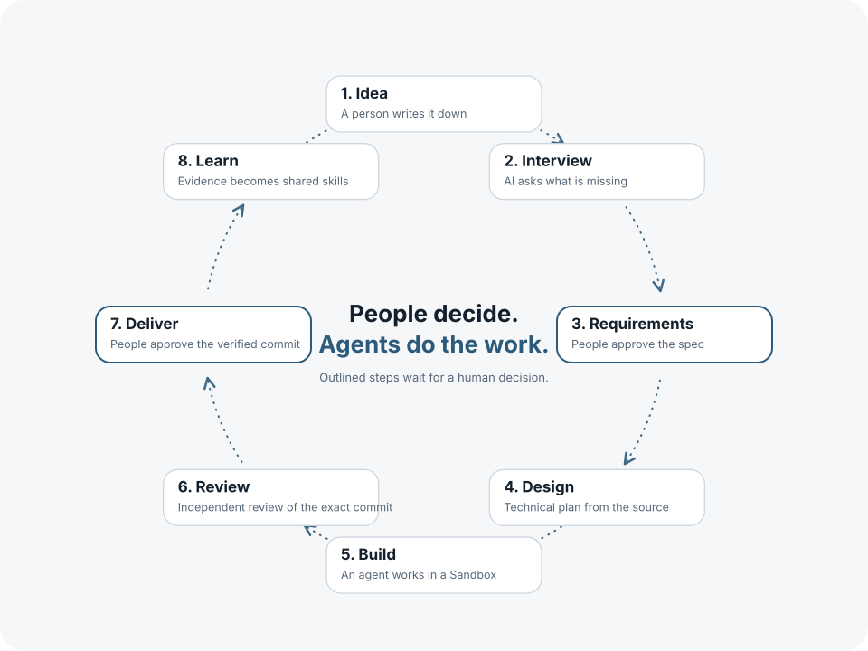
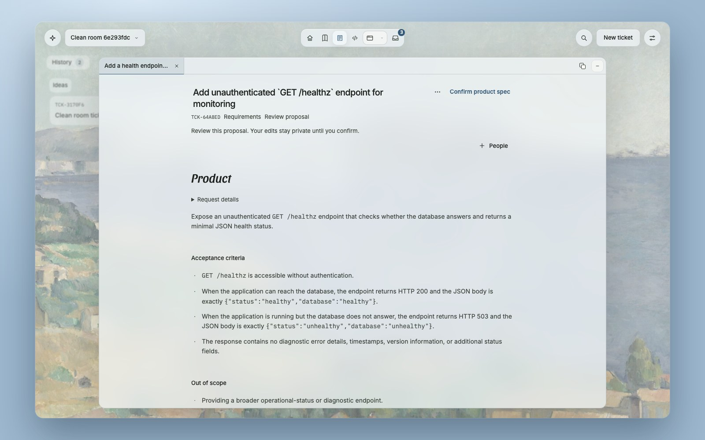
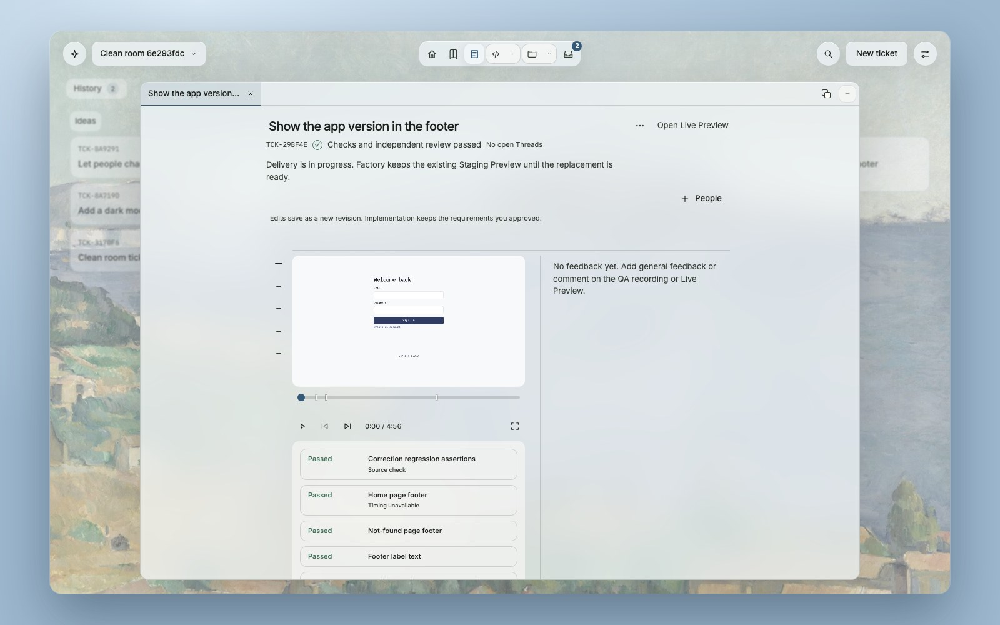

# Open Software Factory

**Self-hosted, requirements-first software development with autonomous coding agents.**
Import your repository with a native `.factory/actor-template.json`, define and approve requirements, and let coding agents implement changes inside isolated Kubernetes Workspaces. Exact-commit verification and independent QA review gate every change before you explicitly approve delivery.

Built on Kubernetes for Linux `arm64` and `amd64`, using **pinned official Substrate** (gVisor + native ActorTemplates) as its sole execution runtime. See [qualification scope](deploy/substrate/README.md#qualification-scope) for the live ARM product path versus component and packaging checks. **Apache-2.0. No telemetry.**

[Quickstart](#quickstart) · [Features](#features) · [Local agents via MCP](#local-agents-via-mcp) · [Architecture](#architecture) · [Commands and test lanes](#commands-and-test-lanes) · [Install](#install)

<picture>
  <source media="(prefers-color-scheme: dark)" srcset="assets/lifecycle-dark.svg">
  
</picture>

## Quickstart

### Point your coding agent here

Paste this into your coding agent (OpenCode, Claude Code, Codex, Cursor, etc.) from a clone of this repo:

> Set up Open Software Factory locally using [mise](https://mise.jdx.dev): run `mise install` and `mise exec -- bun install --frozen-lockfile`, then check `README.md` and `deploy/helm/factory/README.md` to either connect to my Helm installation (`mise exec -- bun run factory:connect`) or start a local development instance (`mise exec -- bun run factory:up`). Verify health at `/health/ready` and report the URL and any missing Substrate environment variables.

### Run it yourself

**Prerequisites:** [mise](https://mise.jdx.dev) (installs pinned Bun, Node, Go, Python, `kubectl`, `helm`, `kubeconform`, `mkcert`) and OrbStack/Docker (for local development) or a Kubernetes cluster with official Substrate commissioned.

```sh
# 1. Install pinned toolchain and dependencies
mise install
mise exec -- bun install --frozen-lockfile

# 2a. Connect to an existing local Helm installation (recommended for cluster installs)
mise exec -- bun run factory:connect

# 2b. Or start the local source launcher (requires native Substrate config, TLS origins & browser-tools image:
#     FACTORY_SUBSTRATE_WORKSPACES_CONFIGURATION, FACTORY_FORGEJO_PUBLIC_URL, FACTORY_BROWSER_TOOLS_IMAGE)
mise exec -- bun run factory:up

# 3. Verify health
curl -fsS http://127.0.0.1:3000/health/ready
```

Open `http://127.0.0.1:3000` (the launcher prints the generated admin password path), then configure model providers in **Settings**. For full cluster deployment, TLS, backups, and operations, see the [Helm chart guide](deploy/helm/factory/README.md).

## Features

| Capability | What Factory does |
| --- | --- |
| **Requirements-first Tickets** | Manual editing by default — reading or saving never starts inference. Request an optional AI Interview or technical design when needed. Full revision history; **Implement** pins and approves the exact saved revision. |
| **Isolated Substrate Workspaces & IDE** | Direct native Project containers defined in `.factory/actor-template.json` (no nested Docker or Dev Containers). Browser Theia IDE, live App Previews, durable **Suspend / Resume** (native `MEMORY` preferred with `ROOTFS` cold fallback; retained Actor and canonical files stay authoritative), and Yjs real-time Workspace sharing. |
| **Autonomous Coding, Verification & Review** | Coding agents implement approved specs in isolated Workspaces. Exact-commit verification and independent review (with an App QA recording) run on the same commit before explicit human Delivery approval (or eligible delegation) promotes to Staging. |
| **Wiki, Skills, MCP & Operations** | Self-updating Project Wiki with revisions and human edits; scoped Skills (private personal library or manager-pinned Project/System versions); external MCP servers + remote `/api/mcp`; OpenBao Environments; Releases; Monitoring; Learning proposals; and Inbox. |
| **Enterprise Security Boundaries** | gVisor sandbox isolation and restricted TLS egress, OpenBao secret encryption, fail-closed private OCI image pull trust, private-by-default Workspaces, and strict role separation across Contributors, Developers, Project Managers, and Administrators. |

### From requirements to verified delivery

<details open>
<summary><strong>1. Requirements &amp; spec approval</strong> — author manually or run an AI Interview before implementation</summary>
<br>

</details>

<details>
<summary><strong>2. Isolated Workspace, Theia IDE &amp; live Preview</strong> — inspect code, collaborate via Yjs, and pause/resume durably</summary>
<br>

</details>

<details>
<summary><strong>3. Exact-commit Verification, QA recording &amp; Delivery</strong> — inspect checks and App QA video before promoting to Staging</summary>
<br>

</details>

## Local agents via MCP

Use your own local coding agent directly against Factory's remote Substrate compute — no Factory-specific plugin required. Factory authenticates clients via user OAuth with PKCE and never imports your local browser sessions or model credentials.

```sh
# OpenCode V2 (other MCP clients use the same URL and OAuth PKCE flow)
opencode mcp add factory --url https://YOUR_FACTORY/api/mcp
# Then sign in via /mcps
```

- **Workspace lifecycle**: `listProjects`, `listWorkspaces`, `listTicketWorkspaces`, `openWorkspace`, `startWorkspace`, `pauseWorkspace`. Commands and container-file access wake paused compute automatically without restarting explicitly stopped/failed compute or starting AI inference.
- **Files, transfers & terminals**: Checkout-relative or absolute container file tools with optimistic version checks; `beginFileTransfer` / `commitFileTransfer` for SHA-256-verified binary transfers up to 128 MiB; remote commands survive laptop disconnects.
- **Collaboration & Ticket handoff**: `shareWorkspace` grants observation or collaboration on personal Workspaces; `readSharedDocument`, `editSharedDocument`, and `saveSharedDocument` edit live Yjs buffers under your authenticated identity; `takeOverTicketEditing` handles explicit writer handoff for Ticket Workspaces.

## Architecture

Factory owns product authority, approvals, and execution intent; pinned official **Substrate** owns Actor lifecycle and snapshots through Factory's adapters. See [deploy/substrate/README.md](deploy/substrate/README.md) for the runtime contract, gVisor profile, and [Project images and native preparation](deploy/substrate/README.md#project-images-and-native-preparation).

| Path | Responsibility |
| --- | --- |
| `apps/factory/` | Solid 2 + TanStack Start web application, authenticated server functions, Zero planning sync, Mastra orchestration, OpenCode V2 client, and feature controllers (`tickets`, `change`, `workspace`, `agent`, `delivery`, `knowledge`, `learning`, `environments`, `skills`, `mcp`, `releases`, `monitoring`, `inbox`). |
| `packages/` | Pure domain modules (`change-domain`, `ticket-domain`, `workspace-domain`, `runtime-domain`, `project-domain`, `knowledge-domain`, `identity-domain`, `requirement-domain`, `conversation-domain`, `interface-domain`), Drizzle PostgreSQL schema & sealed baseline (`db`), Zero schema & Solid bindings (`zero-schema`, `zero-solid`), Better Auth (`auth`), Forgejo adapter (`forge`), Kubernetes/Substrate profile (`runtime-kubernetes`), and `system-contract`. |
| `services/` | Go runtime services: `runtime-connector` (in-Actor connector) and `substrate-control` (Substrate API/router bridge). |
| `deploy/` | Production [Helm chart](deploy/helm/factory/README.md), [Substrate operator profile](deploy/substrate/README.md), container images (`factory`, `theia-ide`, `runtime-host`, `browser-tools`, `language-tools`, `opencode-server`), and local Compose services. |
| `test/` | Playwright browser journeys (`test/browser/`), controller/database/native integration suites (`test/integration/`), TLA+ writer safety model (`test/models/`), and shared fixtures (`test/fixtures/`, `test/support/`). |
| `scripts/` & `templates/` | Local launcher, test lane runners, release qualification gates, and starter/release templates. |

## Commands and test lanes

Always invoke commands via `mise exec --` to use the pinned toolchain.

### Local lifecycle & schema checks

| Command | Purpose |
| --- | --- |
| `mise exec -- bun run factory:up` | Start local development Factory and print admin credentials. |
| `mise exec -- bun run factory:connect` | Keep local port-forwards open to a Helm-installed Factory without restarting it. |
| `mise exec -- bun run factory:status` / `factory:restart` | Inspect or restart the local development installation. |
| `mise exec -- bun run factory:reset` | Reset a named disposable installation (requires explicit confirmation; never touches Substrate resources). |
| `mise exec -- bun run check` | Fast full source gate: `check:docs`, `db:check`, `zero:check`, `format:check`, `lint` (incl. architecture rules), `typecheck`, `test:unit`, `connector:check`, and `substrate:check`. |
| `mise exec -- bun run check:docs` | Validate Markdown fences, local images, links, and heading anchors across all docs. |
| `mise exec -- bun run db:check` / `db:generate` | Check or regenerate the sealed Greenfield Drizzle + PostgreSQL baseline (`packages/db/`). |
| `mise exec -- bun run zero:check` / `zero:generate` | Check or regenerate the allowlisted Zero planning schema (`packages/zero-schema/`). |
| `mise exec -- bun run connector:check` / `substrate:check` | Run Go race tests and `go vet` for `runtime-connector` (host + Linux) and `substrate-control`. |

### Test lanes & release qualification

| Command | Scope & notes |
| --- | --- |
| `mise exec -- bun run test:unit` | Fast unit and domain tests (no external services). |
| `mise exec -- bun run test:controllers [path]` | Database & controller integration tests. Pass an exact file/filter (e.g. `test/integration/inbox.test.ts`), or shard in parallel with `--shard=1/2` and `--shard=2/2`. |
| `mise exec -- bun run test:browser [spec]` | Playwright UI journeys against an owned fixture (`test:browser:native` and `test:browser:paid` for native/paid lanes). Supports Playwright `--shard` args. |
| `mise exec -- bun run test:native [filter]` | Native service/runtime integration tests (`runtime:conformance` runs Substrate adapter & Workspace conformance). See [scripts/runtime/README.md](scripts/runtime/README.md). |
| `mise exec -- bun run test:live` | Explicit paid-model live acceptance lane (never part of default tests). |
| `mise exec -- bun run test:formal` | Optional TLA+ bounded Writer safety model check (macOS arm64 pinned Temurin/TLC). |
| `mise exec -- bun run check:integration` | Runs `check` plus the full controller suite. |
| `mise exec -- bun run beta:gate` | Exact-commit source/controller/UI receipt (including Connector & Substrate bridge checks; not native product acceptance). |
| `mise exec -- bun run release:clean-room` | Fresh-install clean-room qualification with explicitly owned cluster inputs. |

> For disposable source-launcher fixture lanes using `factory-mutation/runtime-fixture`, seed explicitly after startup:
> `mise exec -- bun scripts/factory/index.ts prepare-fixture --disposable YOUR_PROOF --confirm YOUR_PROOF`

### Feature check index

Map user actions directly to their owning code and focused regression checks (controlled fixtures complement, but do not replace, native product acceptance):

| User action | Code owner | Focused check |
| --- | --- | --- |
| Manage access or register a Project | [Access](apps/factory/src/access/controller.ts), [Projects](apps/factory/src/projects/service.ts) | `bun run test:controllers project-registration-authority project-access` |
| Save requirements & Implement exact revision | [Ticket documents](apps/factory/src/change/document.ts), [Change admission](apps/factory/src/change/controller.ts) | `bun run test:controllers change-document-drizzle implementation-admission technical-planning` |
| Create Ticket, switch Projects, retain edits | [Desktop commands](apps/factory/src/desktop/project-commands.ts), [Ticket editor](apps/factory/src/tickets/ticket-workspace.tsx) | `bun run test:browser requirements-entry.spec.ts ticket-autosave-ack.spec.ts board-navigation.spec.ts` |
| Open Source, IDE, or shared Workspace | [Workspace](apps/factory/src/workspace/service.ts) | `bun run test:controllers developer-ide workspace-sharing workspace-commands`; native fixtures in [scripts/runtime](scripts/runtime/README.md) |
| Start Coding or Stop admitted work | [Coding](apps/factory/src/agent/controller.ts) | `bun run test:controllers implementation-admission`; `bun run test:native substrate-coding-stop` |
| Verify, review & deliver a candidate | [Delivery](apps/factory/src/delivery/controller.ts), [Review](apps/factory/src/agent/candidate-review.ts) | `bun run test:controllers candidate-review-delivery delivery-controller-drizzle parallel-delivery` |
| Generate or update the Wiki | [Knowledge](apps/factory/src/knowledge/generation-workflow.ts) | `bun run test:unit plan-coverage generation-speed`; `bun run test:controllers wiki-generation wiki-human-edits wiki-resume` |
| Review completed work & Learning proposals | [Learning](apps/factory/src/learning/service.ts) | `bun run test:unit apps/factory/src/learning/`; `bun run test:browser learning.spec.ts` |
| Qualify installation, backup & isolation | [Chart](deploy/helm/factory/README.md), [Substrate](deploy/substrate/README.md) | `bun run release:clean-room` (owned inputs); `bun run connector:check` |

## Install

Install and qualify pinned official Substrate on matching `arm64` or `amd64` workers first, then deploy Factory with digest-pinned images, public TLS origins, and Substrate credentials in `private-values.yaml`:

```sh
mise exec -- kubectl create namespace factory
mise exec -- kubectl label namespace factory ate.dev/api-access=true
mise exec -- helm install factory ./deploy/helm/factory \
  --namespace factory --create-namespace --values private-values.yaml \
  --wait=legacy --timeout 20m
```

With Ingress enabled, the chart automatically issues and renews HTTPS certificates (or accepts an enterprise TLS Secret). Keep execution and editor namespaces unlabelled. See [deploy/helm/factory/README.md](deploy/helm/factory/README.md) for prerequisites, Router identity commissioning, backups, and recovery.

---

Built with Solid 2, TanStack Start, Bun, PostgreSQL, Zero, Mastra, OpenCode V2, Forgejo, and OpenBao.
Contributor policy: [AGENTS.md](AGENTS.md) · Bugs: GitHub Issues · Security: [SECURITY.md](SECURITY.md) · License: [Apache-2.0](LICENSE)
