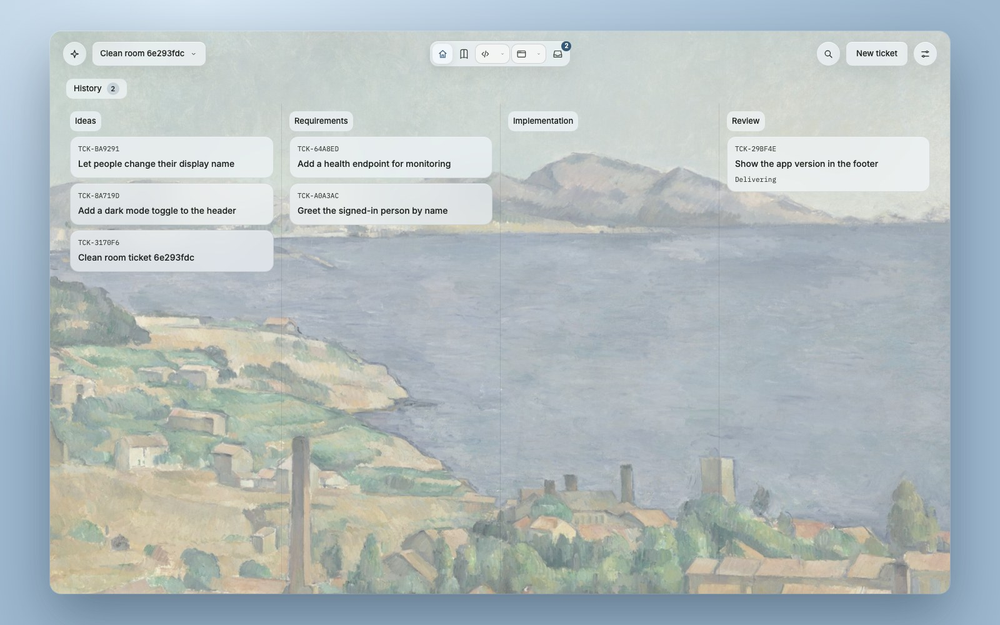
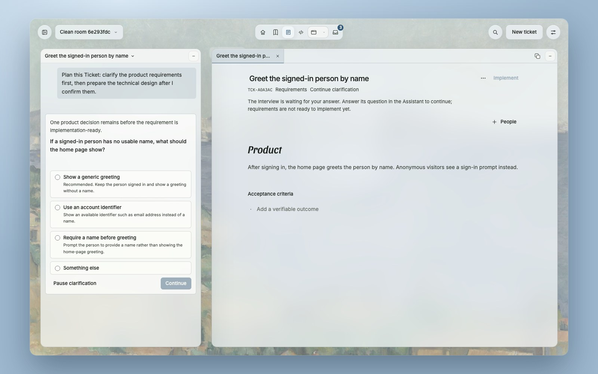
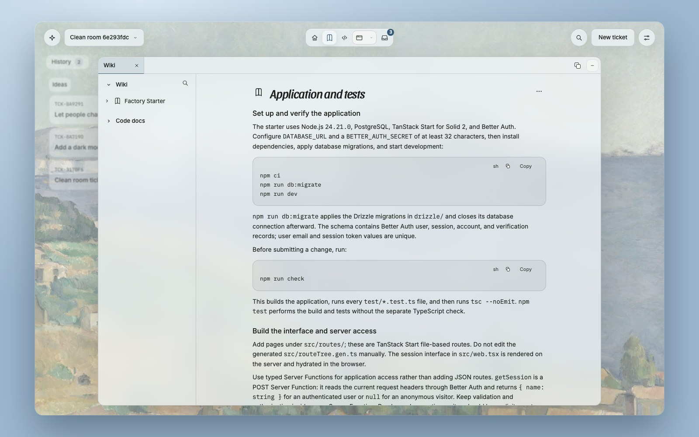
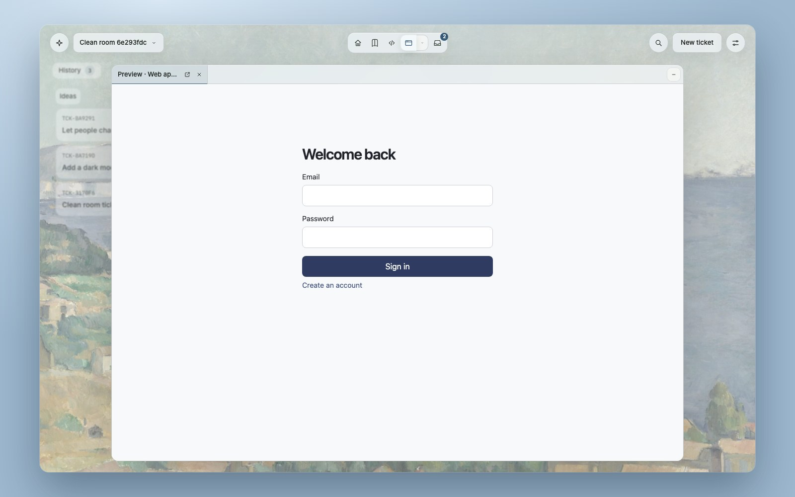
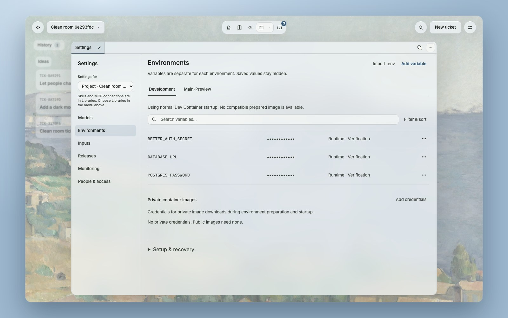

<div align="center">



# Open Software Factory

**You decide what gets built. Agents build it in isolation, and prove it.**

A self-hosted software factory. People approve the requirements and the verified commit.
Agents do everything between those two decisions, inside Sandboxes that pause with their memory.

[](LICENSE)
[](https://github.com/maxcodefaster/open-software-factory/releases)
[](#where-it-runs)
[](SECURITY.md)

[Why](#why-factory) · [The cycle](#the-cycle) · [Features](#features) · [Factory Box](#factory-box) · [Where it runs](#where-it-runs) · [Install](#install) · [Develop](#developing)

</div>

---

## Why Factory

Coding agents write code faster than people can read it. The bottleneck moved. It is no longer typing,
it is trust: what did the agent build, did it build the right thing, and can it run somewhere that
cannot hurt anything else.

Factory is built on three beliefs.

- **People decide twice.** They approve the requirements before work starts, and the exact verified
  commit before it ships. Everything in between runs without asking for attention.
- **An agent needs a real machine.** Not a chat window and not a stripped sandbox. A Sandbox has your
  Dev Container, its own Docker daemon, a live Preview and an IDE. It pauses with its RAM and
  resumes where it stopped.
- **A claim needs evidence.** Verification runs on the exact commit, an independent review reads that same
  commit, and Factory records which decision authorized which change.

It is open source, self-hosted and sends no telemetry. Your source stays in your Forgejo, your
secrets stay in your OpenBao, and you choose the models.

## The cycle

<picture>
  <source media="(prefers-color-scheme: dark)" srcset="assets/lifecycle-dark.svg">
  
</picture>

## Features

### A board that shows where work stands


Tickets move from Ideas through Requirements and Implementation to Review. Every Project has its own
board, History and Trash, and every Ticket has an address you can share.

### An interview that asks only what the source cannot answer



Write a sentence or a full spec. The interview reads the repository first and asks only what it cannot
settle itself, one decision at a time, each with a recommended answer.

### A spec you can approve line by line


The result is a product spec with testable acceptance criteria and a clear list of what is out of
scope. Nothing gets built until a person confirms it. A technical design follows from the real source.

### An agent that works where you would


Implementation runs in a Sandbox with your Project's Dev Container. Open the IDE while the agent works
and its cursor follows the edits. Open the Preview and see the running App, not a description of it.

### Review before delivery


Verification runs on the exact commit. An independent reviewer reads that same commit and records a
QA session of the running App. Only then does Factory offer Delivery, and a person presses the button.

### A Wiki that stays true to the code



Factory writes guides from the repository and updates them when the source changes. Pages keep their
revisions, people can edit them, and the next update respects the edit.

### Sandboxes that pause with their memory



An idle Sandbox pauses and gives its RAM back. The next click resumes the same processes where they
stopped. Staging keeps running for the people who review.

### Access, secrets and backups you can reason about



Roles separate product work from development and administration. Secrets live encrypted in OpenBao and
stay hidden in the interface. Backups cover the database, Git and the object store, and a restore
rehearsal proves they work. Repeated corrections and review findings become proposed skills, and people
decide what the agents learn.

## Factory Box

Every Sandbox runs in **Factory Box**, a separate runtime that Factory uses as its execution layer
([maxcodefaster/factorybox](https://github.com/maxcodefaster/factorybox)). It runs each Sandbox as a
Linux system container on [Sysbox](https://github.com/nestybox/sysbox), so the Sandbox can run its own
Docker daemon without a privileged container. It uses [CRIU](https://criu.org) to checkpoint a running
Sandbox, RAM included, and restore it later.

The philosophy is practical. A microVM gives the strongest wall, but it needs hardware virtualization,
and most managed Kubernetes nodes do not offer it. A plain container is light but cannot be a real
development machine. Factory Box takes the middle: a full development environment that runs on an
ordinary Kubernetes node, with no special kernel build.

| | Plain container | gVisor | MicroVM (Firecracker, Kata) | **Factory Box** |
| --- | --- | --- | --- | --- |
| Kernel | Shared with the node | Userspace kernel | Own guest kernel | Shared with the node |
| Docker daemon inside | Needs a privileged container | Limited | Yes | Yes, private per Sandbox |
| Pause with memory | No | Checkpoint support | Snapshot | Yes, in seconds |
| Needs hardware virtualization | No | No | Yes | No |
| Runs on ordinary managed nodes | Yes | With a runtime class | Rarely | Yes |
| Strength of the wall | Weakest | Medium | Strongest | Medium |

The trade is stated plainly. A shared kernel means a kernel bug is a node bug. A microVM escape is also
possible, as published research shows, but the wall is higher. That is why Factory keeps one worker per
installation, runs Sandboxes in user namespaces, and refuses nodes that fail its capability check.
Give untrusted tenants their own installation and their own nodes.

## Where it runs

Factory is plain Kubernetes: one Helm chart, no cloud specific resources and no operator to trust.
The same chart runs on a laptop with OrbStack, on a server with k3s and on a managed cluster, and it
scales out by adding nodes. The node needs a recent Linux kernel and permission for one privileged
worker Pod. The worker checks the node's kernel capabilities before it admits any Sandbox.

| Platform | Status in v0.1.0-beta.1 |
| --- | --- |
| Linux arm64 on Kubernetes | Verified: install, upgrade without data loss, pause and resume, soak runs |
| Linux amd64 | Runs on k3s in tests, full verification is next |
| Azure AKS | Not verified yet |

## Install

```sh
helm install factory oci://ghcr.io/maxcodefaster/charts/factory --version 0.1.0-beta.1 \
  --namespace factory --create-namespace --values private-values.yaml \
  --wait=legacy --timeout 20m
```

`private-values.yaml` names your node and your public addresses. The chart pins the released Factory
image and the signed worker, and generates every credential. The
[chart README](deploy/helm/factory/README.md) covers prerequisites, storage, backups, node hardening,
managed clusters and recovery. From v0.1.0 on, every chart upgrade is tested with data and loses none.

## Developing

Source development needs macOS with OrbStack (Linux Docker daemon, Kubernetes context `orbstack`)
and [mise](https://mise.jdx.dev).

```sh
mise install
mise exec -- bun install --frozen-lockfile
mise exec -- bun run factory:up
```

Open [http://127.0.0.1:3000](http://127.0.0.1:3000). The launcher generates the administrator password
for `admin@factory.local`, writes it to `.factory/` and prints the path. Provider connections are
configured in Settings, and [.env.example](.env.example) lists optional bootstrap values.

| Command | Purpose |
| --- | --- |
| `bun run check` | Docs, format, lint, types, unit tests and Connector checks |
| `bun run check:integration` | Adds PostgreSQL invariants and the owned controller lane |
| `bun run test:browser` | UI journeys against an owned Factory |
| `bun run test:native` | Real OpenCode, source, Forgejo and OpenBao adapters |
| `bun run runtime:conformance` | Factory Box, Kubernetes, Dev Containers and Connector together |
| `bun run beta:gate` | Every lane plus secret and forbidden-term scans, with a receipt for the exact commit |
| `bun run release:clean-room` | Install a chart on a fresh Namespace, prove it works, remove it |
| `bun run release:upgrade-test` | Upgrade a previous build on a fresh Namespace and prove no data is lost |
| `bun run release:soak` | Long run with Preview, pause, resume, Wiki and backup cycles |

GitHub runs the checks only for release tags and by hand. [AGENTS.md](AGENTS.md) holds the rules for
coding agents in this repository.

```text
apps/factory/               Web interface, HTTP server and Factory controllers
packages/                   Domain rules and concrete integration adapters
services/runtime-connector/ Go connector inside the approved runtime
deploy/                     Helm chart, upstream compositions and runtime images
scripts/                    Local operation, integration, release and runtime tools
templates/starter-app/      Maintained application scaffold for new Projects
test/                       Browser, integration and live proofs with owned fixtures
```

## Built on

TanStack Start with Solid 2, Bun and PostgreSQL. Zero syncs the interface. Mastra runs research and
interviews. OpenCode implements approved Changes. Forgejo owns Git and Verification. Sysbox and CRIU run
the Sandboxes inside Factory Box. OpenBao holds the secrets.

## Contributing and security

Report bugs as GitHub issues. Report vulnerabilities as described in [SECURITY.md](SECURITY.md).
Factory is licensed under [Apache-2.0](LICENSE). Bundled third-party assets keep their own notices.
